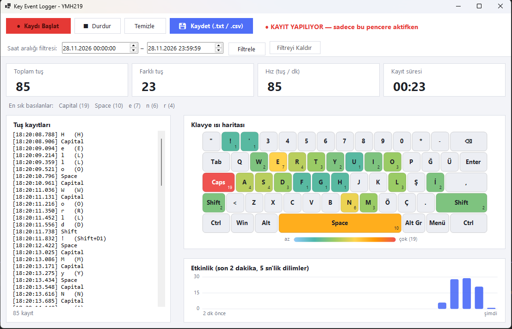

# Key Event Logger (Eğitsel)

Nesne Tabanlı Programlama (YMH 219) dersi ek uygulama ödevi.
Windows Forms'ta klavye olaylarının (KeyDown / KeyUp) nasıl yakalandığını ve işlendiğini gösteren eğitsel bir uygulamadır.
Uygulama **yalnızca kendi penceresi aktifken** basılan tuşları kaydeder.

## Kullanılan Teknolojiler
- C# / .NET 10
- Windows Forms
- `StreamWriter` ile dosya işlemleri
- Harici NuGet paketi kullanılmamıştır.

## Özellikler
- Basılan tuşun adı ve zamanı (`HH:mm:ss.fff`) listede gösterilir
- Ctrl / Shift / Alt kombinasyonları birlikte gösterilir (ör. `Ctrl+Shift+S`)
- **Başlat / Durdur** ile kayıt kontrolü
- **Temizle** ile ekrandaki kayıtları silme
- **Kaydet** ile kayıtları `.txt` dosyasına yazma
- Kayıt durumunu gösteren renkli gösterge (kırmızı: kayıt yapılıyor, gri: durduruldu)
- Toplam tuş sayısı ve en sık basılan 3 tuş istatistiği
- Basılı tutulan tuş tekrar tekrar kaydedilmez (KeyUp ile takip edilir)

## Sınıf Yapısı
| Sınıf | Görevi |
|---|---|
| `KeyLogEntry` | Tek bir tuş olayı (tuş, değiştiriciler, zaman) |
| `KeyEventRecorder` | Kayıt durumu, kayıt listesi, istatistikler |
| `LogFileWriter` | Kayıtları .txt dosyasına yazma |
| `Form1` | Arayüz ve olayların bağlanması |

## Kurulum ve Çalıştırma
1. Depoyu klonlayın:
   ```
   git clone https://github.com/YasirCelikStack/YMH219-KeyEventLogger.git
   ```
2. `YMH219-KeyEventLogger.slnx` dosyasını Visual Studio 2026 ile açın (.NET 10 SDK gerekir).
3. `F5` ile çalıştırın.
4. **Başlat**'a basın ve pencere açıkken klavyeyi kullanın.

## Ekran Görüntüleri



## Bilinen Sınırlamalar / Geliştirme Notları
- Tuş adları `Keys` enum'undan gelir; Türkçe karakter tuşları (ş, ğ, ö...) `Oem1`, `OemOpenBrackets` gibi adlarla görünebilir.
- Bilinçli olarak global klavye kancası (global hook) kullanılmamıştır: başka uygulamalardaki tuşlar kaydedilmez, uygulama arka planda çalışmaz, kayıtlar ağa gönderilmez.

## Geliştiren
- Ad Soyad: ...
- Öğrenci No: ...
