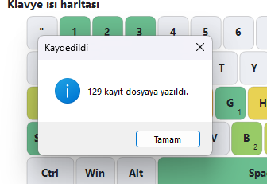

# Key Event Logger (Eğitsel)

Nesne Tabanlı Programlama (YMH 219) dersi ek uygulama ödevi.
Windows Forms'ta klavye olaylarının (KeyDown / KeyUp) nasıl yakalandığını ve işlendiğini gösteren eğitsel bir uygulamadır.
Uygulama **yalnızca kendi penceresi aktifken** basılan tuşları kaydeder.

## Kullanılan Teknolojiler
- C# / .NET 10
- Windows Forms
- `StreamWriter` ile dosya işlemleri
- Harici NuGet paketi kullanılmamıştır.

## Özellikler
- Basılan tuşun adı ve zamanı (`HH:mm:ss.fff`) listede gösterilir
- **Gerçek karakter gösterimi:** `KeyPress` olayıyla tuşun ürettiği karakter de alınır; Türkçe harfler doğru görünür
  (ör. `ş   (Oem1)`: önce karakter, parantez içinde `KeyDown`'dan gelen fiziksel tuş adı)
- Ctrl / Shift / Alt kombinasyonları birlikte gösterilir (ör. `Ctrl+Shift+S`)
- **Başlat / Durdur** ile kayıt kontrolü
- **Temizle** ile ekrandaki kayıtları silme
- **Kaydet** ile kayıtları `.txt` dosyasına yazma
- **Saat aralığına göre filtreleme** *(isteğe bağlı)*: başlangıç–bitiş tarih/saati seçilip **Filtrele**'ye basılır;
  liste ve `.txt` kaydı sadece o aralıktaki tuşları içerir, **Filtreyi Kaldır** ile tüm kayıtlar geri gelir
- Kayıt durumunu gösteren renkli gösterge (kırmızı: kayıt yapılıyor, gri: durduruldu)
- Toplam tuş sayısı ve en sık basılan 3 tuş istatistiği (`a` ile `Shift+A` aynı tuş sayılır)
- Basılı tutulan tuş tekrar tekrar kaydedilmez (KeyUp ile takip edilir)

## Sınıf Yapısı
| Sınıf | Görevi |
|---|---|
| `KeyLogEntry` | Tek bir tuş olayı (tuş, değiştiriciler, zaman, üretilen karakter) |
| `KeyEventRecorder` | Kayıt durumu, kayıt listesi, KeyDown–KeyPress eşleştirme, filtreleme, istatistikler |
| `TimeRange` | Filtrede kullanılan tarih/saat aralığı (`record struct`) |
| `LogFileWriter` | Kayıtları .txt dosyasına yazma |
| `Form1` | Arayüz ve olayların bağlanması |

## Kurulum ve Çalıştırma
1. Depoyu klonlayın:
   ```
   git clone https://github.com/YasirCelikStack/YMH219-KeyEventLogger.git
   ```
2. `YMH219-KeyEventLogger.slnx` dosyasını Visual Studio 2026 ile açın (.NET 10 SDK gerekir).
3. `F5` ile çalıştırın.
4. **Başlat**'a basın ve pencere açıkken klavyeyi kullanın.

### Olay sırası (nasıl çalışır?)
Bir tuşa basıldığında Windows Forms sırayla üç olay gönderir:
1. `KeyDown` → fiziksel tuş (`Keys.Oem1`) ve Ctrl/Shift/Alt durumu. Kayıt burada oluşturulur.
2. `KeyPress` → klavye düzenine göre üretilen karakter (`ş`). Sadece karakter üreten tuşlarda gelir; son kayda eklenir.
3. `KeyUp` → tuş bırakıldı. Basılı tutma tekrarlarını ayırt etmek için kullanılır.

## Ekran Görüntüleri



## Bilinen Sınırlamalar / Geliştirme Notları
- Karakter üretmeyen tuşlar (F1, oklar, Shift) `Keys` enum adıyla gösterilir.
- Filtre kutularına saat yazılırken tuşlar kaydedilmez (kutular normal çalışsın diye).
- Bilinçli olarak global klavye kancası (global hook) kullanılmamıştır: başka uygulamalardaki tuşlar kaydedilmez, uygulama arka planda çalışmaz, kayıtlar ağa gönderilmez.

## Geliştiren
- Ad Soyad: Muhammet Yasir Çelik
- Öğrenci No: 250542010
